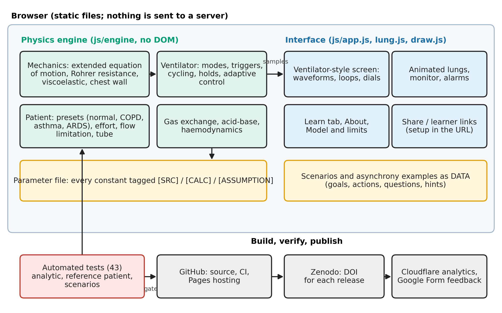
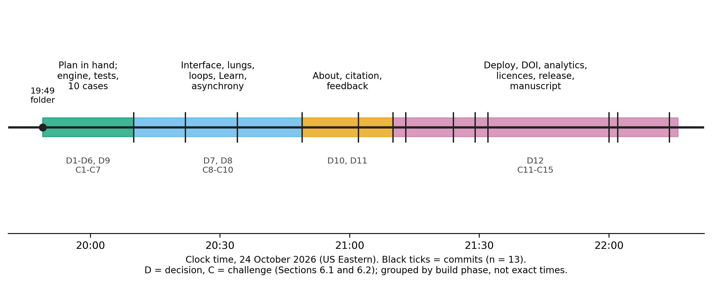

# From idea to deployment: using AI coding assistance to build niche, personalisable simulation web apps for medical education. A case study of a free, open-source ventilator simulator

**Aditya Singh, MD**¹ 
¹ [Internal Medicine, Saint Vincent Hospital, Worcester, MA, USA]
Corresponding author: [draditya.aiims@gmail.com]
ORCID: [https://orcid.org/0009-0003-3184-7650]

**Article type:** Innovation / technical report with case study (preprint draft v0.1)
**Licence of this text:** CC BY 4.0
**Status:** DRAFT. Items in [BRACKETS] must be completed or checked by the author. No learner data have been collected yet; Section 7 describes the planned evaluation. Do not submit until the checklist at the end is complete. 

---

## Abstract

**Background.** Medical trainees learn complex, high-stakes skills such as mechanical ventilation from a mix of bedside exposure, lectures and, where available, expensive manikin simulation. Commercial simulators are costly and rarely tailored to a single teacher's cases, learners or local protocols. Generative AI coding assistants may lower the cost of building small, focused, browser-based simulators, but there is little practical guidance on how a clinician-educator can go from an idea to a safe, deployed, evaluable tool.

**Objective.** To describe, in reproducible detail, the ideation, design decisions, challenges, integrations and deployment of a free, open-source ventilator simulator built by a physician with an AI coding assistant, and to propose a plan for testing its viability with learners.

**Methods.** Case study. A physician-directed, AI-assisted workflow produced a physics-based simulator (extended equation of motion, viscoelasticity, flow-dependent resistance, expiratory flow limitation, gas exchange and hemodynamics), 10 scenarios, 7 asynchrony examples and a Learn section, deployed as a static website with automated testing, a persistent identifier, an open license, privacy-preserving analytics and a feedback channel. We logged decisions and problems as they occurred and report them in structured tables. We verified the model by analytic tests and agreement with one published cohort.

**Results.** The first working commit was made about 20 minutes after the project folder was created and the archived, citable release followed about 2 hours later on the same evening [CONFIRM, see Section 5.1]. The deliverable is about 2,100 lines of code and markup, including 425 lines of physics engine, 43 automated tests, and recurring running costs of zero for hosting, archiving, analytics and feedback (the AI assistant itself was not free). Twelve decision points and fifteen problems are documented. Several defects were caught by testing against physiological expectations, not by the AI's own first output, including a PEEP-handling inconsistency when adapting the source equation, an expiratory flow-limitation model that failed to reproduce clinically expected PEEP behaviour, and run-away auto-PEEP in scenarios. The model reproduces the mean peak pressure, plateau pressure and auto-PEEP of one published COPD cohort after calibration to it; this is not independent validation. [Learner results: to be added.]

**Conclusions.** A clinician with domain knowledge but without software engineering training can produce a deployable, open, auditable educational simulator in hours with AI assistance. The scarce resources are not code but domain verification, honest labelling of assumptions, clinical review and learner evaluation. We provide a checklist and an evaluation protocol so that others can build, test and share similar niche tools, and we state plainly what has not yet been shown.

**Keywords:** medical education; simulation; mechanical ventilation; generative artificial intelligence; open-source software; personalised learning; patient-ventilator asynchrony

---

## 1. Introduction

### 1.1 The problem
Mechanical ventilation is taught to most trainees in fragments. Concepts that must be linked (settings, airway pressure and flow waveforms, lung mechanics, gas exchange and haemodynamics) are usually presented separately, and practice opportunities depend on who happens to be on service. High-fidelity manikin simulation is effective [CITE: Cook et al., JAMA 2011;306:978] but costly, scarce and difficult to adapt to a particular teacher's cases. Proprietary screen-based simulators are often locked to a vendor's modes and screens. Free browser simulators exist, including a well-regarded respiratory-therapy tool [CITE: RT Maven simulator, T. Piraino; describe neutrally], but each makes design choices that an individual teacher cannot inspect or change.

### 1.2 Why niche, personalisable tools
Teaching often needs a very specific artefact: one patient, one trap, one learner level, one local protocol. Personalisation in this sense is not necessarily adaptive machine learning. It can be as simple as (a) a teacher setting the patient and settings and sending a link; (b) hiding information from the learner so they must infer it; (c) a learner pacing themselves with hints and time acceleration; or (d) a local team editing a threshold or a case in a data file. Such tools are narrow by design and have a small audience, which makes conventional software development poor value. This is the niche that AI coding assistants may open.

### 1.3 Gap and aim
Published descriptions of educational simulators emphasise the finished product or the learning outcome, not the build process, the decisions behind it, or the failure modes of AI-assisted development. For clinician-educators considering the approach, that is the missing information. We aimed to (1) document the end-to-end process from ideation to public deployment, including problems and decisions; (2) report the verification that was and was not achieved; (3) present a reusable checklist; and (4) specify how viability should be tested with learners.

---

## 2. Approach and reporting

### 2.1 Design
Single-case descriptive study of one development project. The author is a physician (internal medicine resident) who acted as product owner, domain expert and reviewer; an AI coding assistant (Claude, Anthropic, via the Claude Code environment) wrote and edited the code and drafted text at the author's direction [CONFIRM model versions and environment for the Methods]. A commit log, test results and the conversation record serve as the data.

### 2.2 Data sources
Git history (12 commits); automated test output; build and deployment logs; the conversation record; the source documents supplied at the outset (a build plan and a parameter sheet); and the external documents reviewed during the project. Dates and counts below come from the repository unless stated.

### 2.3 Reporting guidance
This is a descriptive innovation report. We follow the spirit of SQUIRE-EDU for the educational intervention and describe the evaluation as a protocol, not a result [CITE: Ogrinc et al., SQUIRE-EDU; verify].

### 2.4 Ethics
The development work involved no human participants and no patient data. All clinical values in the tool are simulated. The planned learner evaluation will require review or exemption by an ethics board before any data are collected (Section 7). [Add statement from your board if obtained.]

---

## 3. The idea and the plan

### 3.1 Ideation [CONFIRM and edit: this is the author's story]
The author wanted trainees to see how ventilator settings produce waveforms and blood gases, and to practise troubleshooting without risk. Requirements captured at the start were:
1. a physics-based, not scripted, patient (so that auto-PEEP, asynchrony and alarms emerge from the model);
2. three lung types (normal, COPD, ARDS) with an on-demand arterial blood gas and a live monitor;
3. a game-like set of ten troubleshooting cases with questions, tiered hints and scoring;
4. free, static hosting; no accounts; no patient data;
5. every constant traceable to a source or flagged as an assumption;
6. the author as sole clinical reviewer, with mitigations for that limitation.

### 3.2 A written plan before any code
The work began with two documents prepared with the assistant: a build strategy and master prompt, and a parameter sheet for COPD and ARDS in which every value was tagged [SRC] (from a cited paper), [CALC] (derived) or [ASSUMPTION] (needs clinical judgement). The sheet carried an explicit review box per value. This tagging scheme became the project's main defence against the AI introducing unsourced numbers silently (Section 8.1).

### 3.3 Key early findings
The parameter sheet recorded that a linear single-compartment lung could not reproduce a published COPD cohort's auto-PEEP (9 cmH2O) from its measured resistance and compliance; expiratory flow limitation was needed. This finding fixed the model's structure before it was built and is a good example of the value of reading the data before writing code.

---

## 4. What was built

### 4.1 Architecture
A deliberately small stack: plain JavaScript modules, HTML and CSS, no build step, no server. The physics engine (`js/engine/`, 425 lines) has no dependence on the user interface; the interface only draws its output. Scenarios are data. This separation allowed the physics to be tested headlessly and let all content live in editable data files.

### 4.2 Physics model (summary)
Airway pressure is the sum of elastic recoil (a lung in series with a chest wall; a Venegas sigmoid for ARDS), flow-dependent (Rohrer) resistance for airway and tube, a viscoelastic term and patient muscle pressure, following the extended equation of motion of van Diepen et al. [CITE: Biomed Signal Process Control 2026;118:109770]. Volume above the relaxed lung volume is tracked, so air trapping emerges. Four modes (volume control, pressure control, adaptive pressure control, pressure support/CPAP), flow triggering, holds, patient effort (including reverse triggering and cardiac oscillation), CO2 kinetics with a slow body store, the alveolar gas and shunt equations, haemoglobin saturation, Henderson-Hasselbalch acid-base with chronic compensation, and a simple venous-return model are implemented. Full equations are in the repository and the in-app Model tab.

### 4.3 Educational layer
A ventilator-style screen (large measurements on the left, setpoint dials on the right, bottom tab bar); an animated lung pane (size follows volume, colour follows elastic stress, airway width follows resistance, diaphragm shows patient effort); pressure-volume and flow-volume loops always on screen; triangles marking patient-triggered breaths; a Learn section (how to use, settings, targets, strategies, formulas, expected waveforms generated live by the engine, clinical pearls); 10 scenarios; 7 asynchrony examples; freeze-and-crosshair measurement; and shareable setups.

### 4.4 Personalisation features that exist today
| Feature | What it personalises | Server needed? |
|---|---|---|
| Share link (whole patient + settings in the web address) | A teacher prepares a specific case and sends it | No |
| Learner link (hides patient, examples; optional hidden pressure numbers) | Difficulty: learner must infer the problem from waveforms | No |
| Scenarios as data files | Educators can write new cases without touching the engine | No |
| Tiered hints with a cost; time acceleration; reset | Pace and support | No |
| Unit toggles (cmH2O/kPa, mmHg/kPa, °C/°F) | Local convention | No |
| Not yet implemented: adaptive difficulty from a learner's history; accounts; an authoring interface; multi-language | Future work | Some would |

---

## 5. From idea to deployment: the process

### 5.1 Timeline (from the repository)
| Event | Time (US Eastern, 24 Oct 2026) |
|---|---|
| Project folder created (after the planning documents existed) | 19:49 |
| First commit: engine, simulator, 10 scenarios, tests, deployment workflow | 20:10 |
| Ventilator-style screen, animated lungs, loops, Learn tab | 20:22 |
| Asynchrony examples, new model features, freeze/crosshair, share links | 20:49 |
| About page, citation, disclosures, feedback and analytics hooks | 21:02 |
| Deployed and live on GitHub Pages | ~21:20 [CONFIRM from the Actions log] |
| Persistent identifier (Zenodo DOI) and analytics enabled | 21:29 to 21:32 |
| Open licences, publication materials, archived release v0.2.1 | 22:00 to ~22:10 |

The planning documents pre-date this log, and the elapsed wall-clock time omits the author's thinking time before and between sessions. The numbers describe an expert-directed, AI-assisted run, not a typical novice effort. [Add author's estimate of total hours, including planning.]

### 5.2 Workflow pattern that worked
1. **Specify constraints before features** (static hosting, no accounts, no patient data, source tags).
2. **Build the smallest complete version first**, then iterate (engine and tests, then interface, then content).
3. **Write the contract as tests** (analytic results, reference patient, each scenario: start state fails, correct fix passes, wrong fix fails).
4. **Calibrate against data and expectations**, with the domain expert reading the numbers.
5. **Inspect the running product** in a browser, not only the code.
6. **Review external work** (papers, existing simulators) to find gaps and mistakes, then record the decision.
7. **Deploy early**, then add identity, licence, analytics and feedback.

---

## 6. Decisions and challenges

### 6.1 Decision log
| # | Decision | Alternatives | Why |
|---|---|---|---|
| D1 | Plain JavaScript, no build step, instead of the planned TypeScript/React/Vite/Web Worker stack | Follow the plan | Fastest route to a deployable static site; lowest maintenance for a single author; engine and interface still separate. Cost: no type checking, engine runs on the main thread. |
| D2 | Physics-based patient instead of scripted waveforms | Pre-drawn waveforms per case | Asynchrony, auto-PEEP, alarms emerge and respond to any setting the learner changes. |
| D3 | PEEP enters through airway pressure, not as an added term | Follow the source equation literally | The source adds a separate PEEP term; with recoil measured from the relaxed volume this leaves PEEP with no effect on lung volume (found when checking that PEEP raises volume). |
| D4 | Expiratory flow limitation with a collapse (waterfall) pressure and volume-dependent maximum flow | A simple saturating flow limit | The simple law made extrinsic PEEP add to hyperinflation, contradicting the teaching point. The waterfall form lets low PEEP leave total PEEP unchanged (tested). |
| D5 | Calibrate the COPD preset to one published cohort; keep the default patient milder | Match the cohort for every user | A default sitting on a cliff edge is a poor teaching patient; decompensation is used in scenarios. |
| D6 | Every parameter tagged source, calculated or assumption | Silent defaults | Protects against unverified numbers, enables clinical review. |
| D7 | Generic mode names; no manufacturer branding or proprietary algorithms; a visible non-affiliation notice | Copy a commercial screen exactly | Trademark and misrepresentation risk. The screen follows common layout conventions only. |
| D8 | Loops, lungs and waveforms on one main screen | Tabs | Learners need to see cause and effect together. |
| D9 | Static deployment (GitHub Pages) with tests as a deployment gate | Server hosting | Free, simple, durable, privacy-preserving. |
| D10 | Privacy-friendly, cookieless analytics added later, with an in-app privacy statement | No analytics; Google Analytics | The original promise was "no tracking"; counting users needs a change, disclosed. |
| D11 | Feedback via a hosted form plus email, not a custom server | Own database | No server to run or secure; the form instructs users not to enter patient data. |
| D12 | Open licences (MIT code; CC BY 4.0 content) and a persistent identifier | Keep all rights reserved | Needed for reuse, journal eligibility and citation. |

### 6.2 Challenges log
| # | Problem | How found | Resolution |
|---|---|---|---|
| C1 | Source equation double-counted PEEP | Test that PEEP raises lung volume | Changed formulation (D3) |
| C2 | Linear lung could not reproduce auto-PEEP | Parameter-sheet analysis before coding | Flow-limitation model |
| C3 | Flow-limit model failed the "extrinsic PEEP" teaching expectation | Sweep of PEEP values on the COPD patient | Collapse-pressure waterfall (D4) |
| C4 | Run-away auto-PEEP: COPD scenario hit the pressure cap and blood pressure fell below zero | Calibration run of all scenarios | Volume-dependent maximum flow; floor on modelled blood pressure; cases tuned to stable-but-bad regions |
| C5 | Ineffective-triggering case: efforts could never trigger; metric counted efforts that fell during inspiration | Metric returned 100% missed at every PEEP | Counted only efforts that began in expiration; re-tuned the case |
| C6 | Double-triggering case worked in some patients only | Parameter sweep | Chose patient and settings with a robust signature; recorded the caveat |
| C7 | ARDS preset: shunt of 30% with a P/F of about 150 were mutually inconsistent in the gas model | Calibration against the parameter sheet | Documented the discrepancy, tuned scenario severity |
| C8 | Interface bug: elements meant to be hidden still displayed | Screenshot review | CSS fix |
| C9 | Embedded browser throttled animation to about 2 frames per second, so the simulation looked frozen | Observed in preview | Time-based loop with a larger step cap |
| C10 | Local Python web server failed in the sandbox | Error on start | Used a small Node static server for preview |
| C11 | Analytics token not available before a site address existed | Account setup | Deployed first, then added the token |
| C12 | Deployment failed: Pages not enabled for the repository | Actions run: "Get Pages site failed" | Set Pages source to GitHub Actions; re-ran |
| C13 | Git could not authenticate non-interactively | Push error | Installed the GitHub command-line tool and used browser login (no token typed) |
| C14 | Social-media profile (LinkedIn) blocked automated reading | HTTP 999 | Used a link-aggregator page; left unverifiable credentials for the author to supply |
| C15 | DOI confusion: version DOI vs "all versions" DOI | Reading the archive record | Cite the all-versions DOI |

### 6.3 Integrations
| Integration | Purpose | Cost | Notes |
|---|---|---|---|
| GitHub (repo, Actions, Pages) | Source control, tests as gate, hosting | Free | Public repository needed for free Pages |
| Zenodo | Archive and DOI per release | Free | Reads `CITATION.cff`; two DOIs (version, all versions) |
| Cloudflare Web Analytics | Cookieless page views and approximate unique visitors | Free | Needs a site token; ad blockers undercount |
| Google Forms | Feedback and bug reports | Free | No email collection by default |
| Optional (planned) custom domain and email routing | Professional address | About $10-12 per year | Not used yet |
| Open-source licences | Reuse and journal eligibility | Free | MIT and CC BY 4.0 |

### 6.4 Reviewing other work
Two outside documents were assessed against the project. A published low-cost ventilator design paper [CITE: Giri et al., Mater Today Proc 2021;47:5886] listed settings and targets; the simulator met most of them, and the review also showed where that paper's statements should not be followed (a PEEP ceiling of 10 that conflicts with ARDS practice, an age term in predicted weight, and "stop delivering when the patient breathes" instead of synchronising). A public simulator's user guide [CITE: RT Maven documentation] guided the choice of teaching features (asynchrony examples, share links, a learner mode, crosshair measurement); all text and code in this project are original. Reviewing peers' work was a cheap and productive source of requirements and of cautions.

---

## 7. Verification, and testing viability with learners

### 7.1 What has been verified (technical)
- **Automated tests: 43, all passing.** They cover analytic results (exponential emptying with time constant R×C in the linear limit, closed-form flow equals a numerical root finder, acid-base round trip, alveolar gas and shunt equations, tube pressure drop), a reference patient (normal blood gas on reasonable settings), slow CO2 equilibration, plateau dependence on hold time, auto-PEEP behaviour, the waterfall effect, adaptive-mode convergence, the asynchrony examples, and each of the 10 scenarios (start fails, intended fix passes; two wrong fixes fail).
- **Agreement with one cohort:** with a flow-limitation parameter tuned to it, the COPD preset gives a peak pressure of about 36, plateau of 18 and auto-PEEP of about 9 cmH2O, versus 35, 18 and 9 in the source cohort [CITE: Ann Intensive Care 2021, doi 10.1186/s13613-021-00948-9]. Because this parameter was fitted to those data, this is **calibration, not validation.**
**Table 7.1. Technical validation results** (generated by `scripts/validate.mjs`; re-run to reproduce).

| Check | Result |
|---|---|
| Linear-limit emptying vs exp(-t/tau), tau = 0.150 s | max absolute volume error 1.23 mL |
| Closed-form flow vs numerical root finder | max absolute error 4.4e-16 L/s |
| Tube drop at 1 L/s (K1+K2): 7, 8, 9 mm | 8.11, 5.43, 3.40 cmH2O |
| Alveolar gas equation, room air, PaCO2 40 | PAO2 99.7 mmHg |
| Shunt equation: PaO2 at shunt 0 / 30% (room air) | 99.7 / 53.1 mmHg |
| Severinghaus saturation at P50 26.8 mmHg | 0.499 |
| Reference patient (VT 450, RR 14, PEEP 5), FiO2 0.21 | pH 7.39, PaCO2 40, PaO2 89 |
| Reference patient, FiO2 0.40 | pH 7.39, PaCO2 40, PaO2 180 |
| COPD vs published cohort (qmax 0.10): peak / plateau / auto-PEEP | 36 / 18 / 9.2 cmH2O vs 35 / 18 / 9 (calibrated: not independent) |
| Waterfall: total PEEP with set PEEP 0 vs 4 (flow limited) | 9.2 vs 9.2 cmH2O |
| Adaptive mode after halving compliance (target 450): exhaled VT at breath 1 / 5 / 10 | 388 / 450 / 450 mL |
| PaCO2 after halving rate: start, at 60 min, time to 63% | 40, 75 mmHg, 23 min |
| Plateau at hold 0.25 s vs 3 s | 14.2 vs 13.5 cmH2O |
| Scenarios where start meets goals / fix fails goals | 0 / 0 of 10 |

![Figure 5. Technical validation. A: emptying of a linear lung equals exp(-t/RC). B: the COPD preset against published cohort means as the flow-limit parameter varies (the vertical line marks the value fitted to the cohort). C: in a flow-limited lung, low extrinsic PEEP leaves total PEEP unchanged until it exceeds the airway collapse pressure. D: the adaptive mode restores the target volume within a few breaths after compliance is halved. E: PaCO2 approaches its new level with a time constant of about 23 minutes. F: plateau pressure falls as the inspiratory hold lengthens.](figures/fig4-validation.png)

- **Not done:** comparison with an independent engine (Pulse, BioGears) or published simulation output; clinical review of presets, cases and teaching text; accessibility testing; cross-device testing beyond a desktop browser.

### 7.2 A common risk: tests written by the same author as the code
When the AI writes both the model and the tests, the tests may encode the model's own mistakes. Here, tests were useful because their expectations came from physiology (a lung with PEEP must hold more volume; extrinsic PEEP should not simply add to total PEEP), and because the physician inspected outputs. Independent expert checks remain essential. [Add the expert-review process and results when done.]

### 7.3 Evaluation plan for learners (protocol)
The full protocol, matched quiz forms and survey are in the repository (`docs/publication/`).
- **Framework:** Kirkpatrick levels: reaction (survey), learning (quiz and confidence), behaviour and results (not measured in the first study) [CITE: Kirkpatrick; verify].
- **Design:** single-group pre-post study with two matched 10-item quiz forms, counterbalanced; about 60-minute guided session using the Learn section, five scenarios and two asynchrony examples; short post survey on usability, realism, learning value and mental effort; optional retention quiz at four weeks.
- **Participants and size:** residents and students who have not completed a dedicated ventilator course; about 24 for a paired effect of 0.6 SD at 80% power; convenience sample.
- **Analysis:** paired test (or signed-rank), mean difference with 95% CI, Cohen's dz, form-order check, item difficulty and discrimination; confidence changes; descriptive survey results; thematic coding of comments.
- **Pre-specified success criteria (edit before data collection):** [for example, a mean gain of at least 1.5 of 10 points with a lower confidence bound above 0; at least 80% of learners agree the simulator helped them understand a setting's effect; no content errors reported that change a teaching point after correction].
- **Usage monitoring:** cookieless analytics for page views and approximate unique visitors; a feedback form for bugs and content errors. These show reach and problems, not learning.
- **Safeguards:** ethics review first; voluntary, anonymous, not part of any assessed activity; no patient information collected; clinician pilot of the quiz.
- **Viability beyond learning gains:** maintenance effort (hours per month), number of content errors reported and time to fix, reuse by others (forks, citations, links), and whether a second educator can author a new case from the data format without help.

### 7.4 Results
[To be added: participant numbers and characteristics; pre/post scores; item analysis; confidence; survey; comments; usage statistics for the period; errors reported. Report all results, including null or negative ones.]

---

## 8. Discussion

### 8.1 Principal lessons for clinician-educators using AI assistance
1. **Domain expertise is the bottleneck, not code.** The AI produced working software quickly, but the important contributions were the physician's constraints (no patient data, traceable constants, sole reviewer with mitigations), the choice of what to teach, and the reading of outputs.
2. **Make the AI show its sources.** The source tags and the habit of recording what was verified (and what was only read from a search result or abstract) kept uncertainty visible.
3. **Test against physiology, then inspect.** The most consequential defects (PEEP handling, flow limitation, run-away trapping, a case whose metric could never succeed) were found because someone asked whether the behaviour made clinical sense.
4. **Prefer the smallest complete version, then add.** Starting with a narrow, tested core made later additions (new screen, new modes, examples) low risk.
5. **Be explicit about what the tool is not.** Labelling educational-only use, simulated values, non-affiliation and AI assistance was part of the design from the first commit.
6. **Deployment is part of the education tool.** Hosting, a persistent identifier, a licence, a privacy statement and a feedback path took less time than the physics and have as much effect on adoption and trust.
7. **Treat AI claims about the outside world with suspicion.** Where the assistant could not see a document's figures, reach a page, or confirm a policy, it said so; those gaps were left visible rather than filled in.

### 8.2 Personalisation: where this approach fits
The tool shows low-cost personalisation (teacher-prepared cases via a link, learner-mode hiding, hints, local units and thresholds). Machine-learning-based adaptive tutoring is a different, larger undertaking and is not claimed here. A practical route is to treat cases as data, so educators and, with oversight, AI systems can draft new cases that are then tested automatically (start state fails, fix passes) and clinically reviewed before release.

### 8.3 Comparison with other approaches
Manikin simulation offers physical skills and teamwork that a browser tool cannot. Vendor simulators match one device. Existing free simulators offer strong asynchrony teaching. This tool adds an open, auditable model with parameter provenance and a combined case and teaching layer, and shows a repeatable way to build such tools. [Add neutral, cited comparison.]

### 8.4 Ethics, safety and governance
- **Clinical safety:** wrong teaching can propagate. All clinical content here is draft until reviewed; a visible correction channel exists; version numbers and a DOI let readers know which version taught what.
- **AI-related risks:** fabricated numbers, plausible but wrong text, circular tests, and licence or copyright contamination. Mitigations: source tags, independent review, original text and code, and disclosure.
- **Intellectual property and trademarks:** generic names, no proprietary algorithms, no logos.
- **Privacy:** no accounts, no patient data, cookieless analytics disclosed in the app.
- **Equity and access:** free, runs in a browser, no installation; but depends on internet access, a modern device and English text.
- **Sustainability:** a single maintainer is a risk; open licences and a data-driven design allow others to take over.

### 8.5 Limitations
Single case, single author, single clinical domain. The speed reflects an experienced author directing a capable assistant and is not a promise for novices. AI output varies between runs, so the process is not exactly reproducible; the repository is. The assistant used is a paid product; software hosting and archiving were free but the overall project was not free of cost. The model is a single-compartment lung with unvalidated expiratory behaviour; several parameters are assumptions; hemodynamics are simplified; some modes are absent. No learner data yet; any future evaluation will be a small, single-site, uncontrolled study.

### 8.6 Future work
Clinical review panel and structured review form; independent model comparison; two-compartment lung and more modes; an authoring interface; multi-language support; accessibility audit; multi-site and controlled evaluation with retention testing; study of how well educators other than the author can adapt the tool.

---

## 9. Conclusion
A physician can now create, test and publish a niche educational simulator in an evening with AI assistance, at no hosting cost. What distinguishes a useful tool from a risky one is the human work around the code: clear scope, traceable numbers, physiological testing, honest labelling, review and learner evaluation. We provide the process, decisions, problems and a protocol so that others can do the same, and so that the claims made for such tools are limited to what has actually been shown.

---

## Appendix A. Checklist for building an AI-assisted educational simulator
1. Write the learning objectives and constraints (no patient data, static hosting, open licence).
2. Write a plan and a source-tagged parameter sheet before code.
3. Build the smallest complete version; keep the model and the interface separate.
4. Express the contract as tests; include "wrong fix fails" tests.
5. Calibrate to data, but state that calibration is not validation.
6. Run and look at the product; test on more than one browser and device.
7. Review related work and record what you accept, reject and why.
8. Label: educational use, simulated data, non-affiliation, AI assistance, version.
9. Deploy with tests as a gate; add a persistent identifier, licence, privacy statement, feedback path.
10. Get clinical review; pilot the assessment; obtain ethics approval; then test with learners.
11. Publish all results, including negative ones; keep a changelog and fix reported errors.

## Appendix B. Materials in the repository
Source code (MIT) and teaching content (CC BY 4.0): https://github.com/dradityaaiims-cloud/vent-sim. Live tool: https://dradityaaiims-cloud.github.io/vent-sim/. Archive and DOI (all versions): https://doi.org/10.5281/zenodo.23630782. Protocol, quiz forms, key and survey: `docs/publication/`.

## Declarations
- **Ethics:** no human participants in the development work; learner evaluation requires approval or exemption [add].
- **Funding:** none declared [CONFIRM].
- **Competing interests:** none declared [CONFIRM].
- **AI assistance:** the software, and the first draft of this manuscript and of the quiz and survey materials, were produced with an AI assistant (Claude, Anthropic) under the author's direction. The author is responsible for the content and has [to confirm: reviewed and revised every statement]. AI is not listed as an author.
- **Data and code availability:** see Appendix B.
- **Acknowledgements:** [add].
- **Author contributions (CRediT):** Aditya Singh: conceptualisation, supervision, domain verification, writing (review and editing). [Adjust.]

## References (starter list: verify every entry before submission)
1. Cook DA, et al. Technology-enhanced simulation for health professions education: a systematic review and meta-analysis. JAMA 2011;306:978-988.
2. Issenberg SB, et al. Features and uses of high-fidelity medical simulations that lead to effective learning. Med Teach 2005;27:10-28.
3. van Diepen et al. Biomed Signal Process Control 2026;118:109770.
4. Annals of Intensive Care 2021 COPD ventilation cohort, doi 10.1186/s13613-021-00948-9.
5. Venegas JG, Harris RS, Simon BA. A comprehensive equation for the pulmonary pressure-volume curve. J Appl Physiol 1998.
6. Chatburn RL, et al. Taxonomy for mechanical ventilation. Respir Care 2014.
7. Hardman JG, et al. A physiology simulator: validation of its respiratory components. Br J Anaesth 1998.
8. Serna LY, Hernandez AM, Mananas MA. Computational tool for modeling and simulation of mechanically ventilated patients. IEEE EMBC 2010.
9. Giri J, Kshirsagar N, Wanjari A. Design and simulation of AI-based low-cost mechanical ventilator. Mater Today Proc 2021;47:5886-5891.
10. ARDS Network. Ventilation with lower tidal volumes. N Engl J Med 2000;342:1301-1308.
11. Guerin C, et al. Prone positioning in severe ARDS. N Engl J Med 2013;368:2159-2168.
12. Yang KL, Tobin MJ. A prospective study of indexes predicting the outcome of trials of weaning. N Engl J Med 1991;324:1445-1450.
13. Ogrinc G, et al. SQUIRE-EDU. [verify citation]
14. Kirkpatrick DL. Evaluating training programs. [verify edition]
15. Brooke J. SUS: a quick and dirty usability scale. 1996 (optional instrument).
16. RT Maven Mechanical Ventilator Simulator, documentation (T. Piraino). [verify URL and access date]
17. Kasneci E, et al. ChatGPT for good? On opportunities and challenges of large language models for education. Learn Individ Differ 2023. [verify; add other AI-in-education sources]

## Pre-submission checklist (delete when done)
- [ ] Fill every [BRACKET]; confirm timeline from the Actions log and Zenodo records.
- [ ] Verify every reference against the original; add missing citations for statements marked [CITE].
- [ ] Confirm affiliation wording with your program, and funding and conflicts statements.
- [ ] Clinical review of presets, cases and Learn text; record who reviewed and when.
- [ ] Ethics approval or exemption before any learner data; then add Section 7.4.
- [ ] Add figures: architecture, screenshot, waveform gallery, decision timeline.
- [ ] Re-read the whole text and remove anything that overstates.
